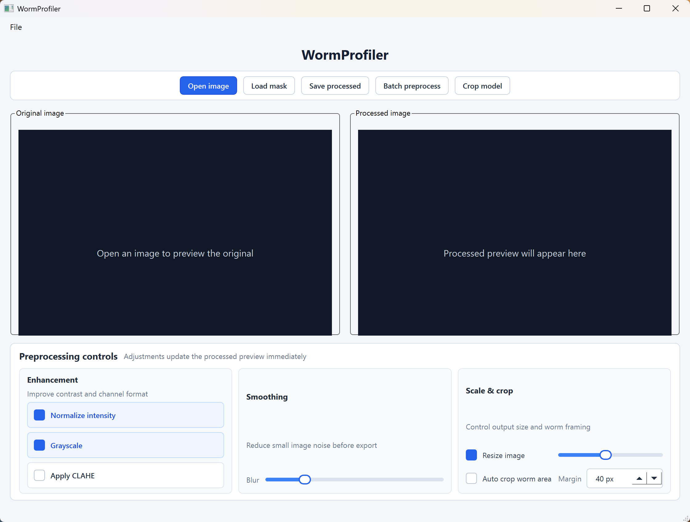
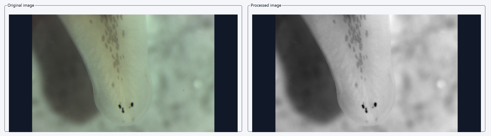
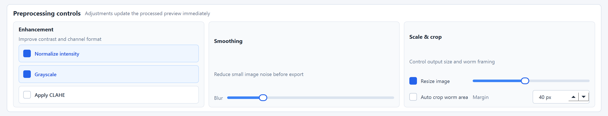
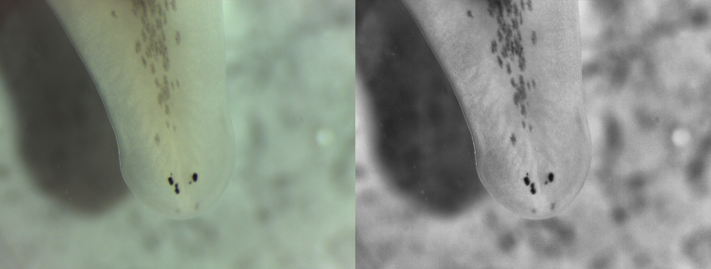
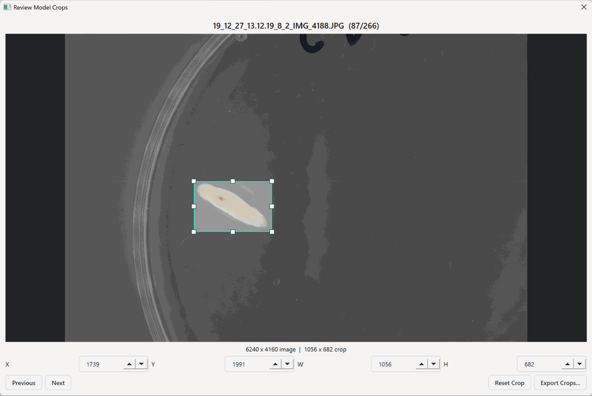
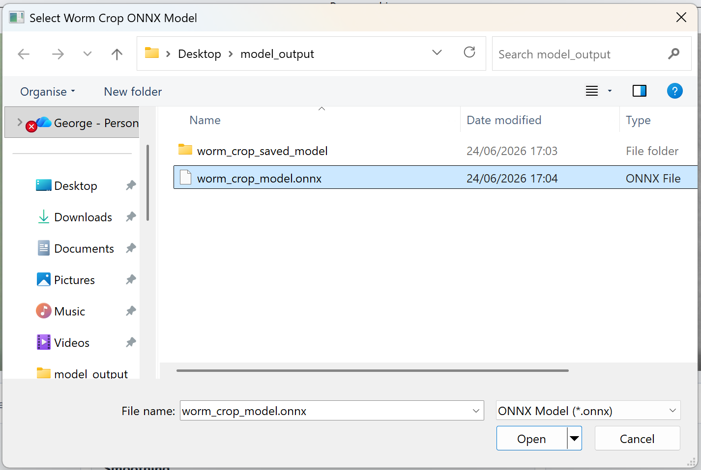
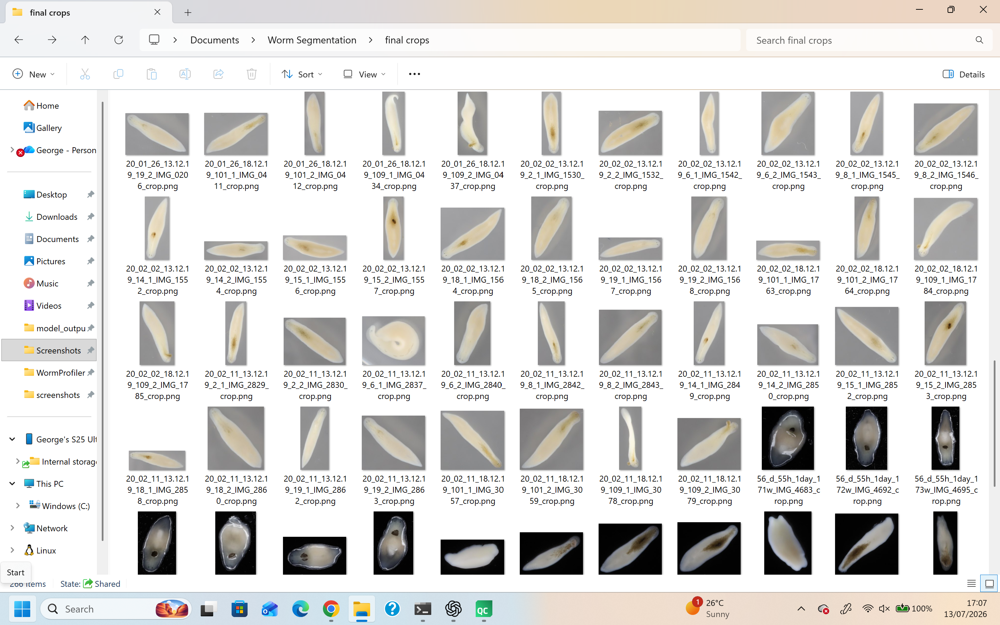

# WormProfiler (Whole section pending overhaul)
'splash screen, morphometrics and wormprofiles'
WormProfiler is a desktop image-preparation, crop-review, and tissue-measurement tool for worm microscopy, built with Qt 6 and OpenCV. Prepare image sets for ilastik, then organise its segmentation TIFFs into dated worm profiles and export tissue areas for time-series analysis.

<p align="center">
  
</p>

The application has two workspaces in one desktop window. **Image preparation** provides a folder browser, original/processed comparison, zoom and pan, and a properties inspector. **Crop review** provides model setup, a review queue, editable bounds, crop previews, decisions, and session export. Switching workspaces preserves the current image settings and review edits.

Open an image or folder to start preparing images. Use **Review > New review** to configure the input folder, ONNX model, margin, and prediction threshold together. Folder processing, model inference, and crop export run in the background with progress and cancellation in the status bar.

## Features

### Side-by-side preprocessing workspace

WormProfiler shows the original image and the processed result next to each other so preprocessing choices can be judged immediately. This makes it easier to tune contrast, blur, grayscale conversion, CLAHE, resizing, and crop settings without losing sight of the raw data.

<p align="center">
  
</p>

### Interactive preprocessing controls

The main window exposes the most common preprocessing operations as direct controls: normalize intensity, convert to grayscale, apply CLAHE, apply Gaussian blur, resize the image, and auto-crop around the worm area. The controls update the processed preview as values change.

<p align="center">
  
</p>

### Intensity normalization

The normalization option rescales image intensities into a consistent display and processing range. This is useful when raw acquisitions differ in brightness, exposure, or background intensity.

### Grayscale and CLAHE enhancement

The grayscale option converts color inputs into single-channel images for workflows that do not need color information. CLAHE can then be applied to improve local contrast, helping faint worm boundaries become easier to inspect and segment.

<p align="center">
  
</p>

### Blur and resize options

The blur slider applies Gaussian blur to reduce small noise before saving or segmentation. The resize option scales images down by a selected percentage, which can make large batches lighter to process while preserving the overall worm shape.

### Classical auto-crop

The auto-crop option uses image processing to estimate the worm region and crop around it with a configurable pixel margin. This gives a fast non-model crop path for images with clear contrast between the worm and background.

<p align="center">
  
</p>

### Model-assisted crop suggestions

WormProfiler can load a trained ONNX crop model and apply it to a folder of raw images. The model predicts a worm probability mask, finds the largest confident worm region, maps that region back to the original image size, and prepares crop rectangles for review.

<p align="center">
  
</p>

### Crop review and manual correction

After model-assisted cropping, proposed crops appear in the integrated Crop review workspace with a thumbnail list and filters for Pending, Approved, Rejected, Needs review, and prediction warnings. The crop box can be moved or resized with handles, and exact X, Y, width, and height values can be adjusted in the properties inspector. Scroll to zoom and use the middle mouse button to pan. Prediction failures are shown explicitly so full-image fallbacks can be checked.

Approve, reject, or flag each image, and optionally advance after each decision. Editing an approved crop returns it to Pending. Save a review session as JSON to preserve crop coordinates, model information, and decisions. Reopen it through **Review > Open session** without rerunning the model. Image paths are stored relative to the session file where possible, so a session and its images can be moved together. Use Open source to inspect a review image in Image preparation.

### Crop export for ilastik

Only crops explicitly marked Approved are exported as PNG files. Crop export supports unsigned 8-bit and 16-bit grayscale, RGB, and RGBA images, preserving their pixel values, bit depth, and actual crop dimensions. Other pixel types are reported as failures instead of silently converted. WormProfiler does not pad crops to a square canvas, so rectangular and squarer worms can be passed to ilastik as independent 2D images.

Each export includes a CSV manifest of all review decisions, source and output paths, crop coordinates, prediction messages, model settings, and export outcomes. Existing crop files and manifests are kept, with numbered filenames used for new exports. Missing sources and images whose dimensions changed are reported as failures.

<p align="center">
  
</p>

### Mask loading and overlay preview

Existing mask images can be loaded and displayed over the original image with a color map. This is useful for checking segmentation outputs against the raw image before committing to downstream measurements.

### Batch preprocessing

Batch export applies the current settings to every supported image in a selected input directory. The settings are captured when the run starts and saved alongside the outputs as a JSON profile. Processed images are written as PNG files with a `_processed` suffix; numbered filenames preserve existing outputs. Processing runs in the background and can be canceled between images.

### Worm profiles and tissue morphometrics

The **Worm profiles** workspace groups multiple ilastik segmentation TIFFs under one worm ID. Assign observation dates with a calendar picker, inspect colour-coded label images, and map the detected label values to Donor, Host, Background, Eyes, or Ignore. Class numbers are not guessed.

Measurements count original label pixels without preprocessing or resizing. Export a chronological CSV with one row per image, observation dates, elapsed days, four region areas, optional calibrated areas in square micrometres, source hashes, notes, and the label mapping. Save and reopen `.wormprofile.json` files to continue a profile later.

The initial morphometrics importer supports single-page, single-channel unsigned 8-bit and 16-bit **Simple Segmentation** TIFFs. Multi-page stacks, floating-point probabilities, and colour renderings are not treated as tissue labels. See the [worm profile guide](docs/worm-profiles.md) for the workflow, CSV fields, and calibration details.

### Preprocessing profile export

The current preprocessing settings can be saved as a JSON profile and restored from the **Profiles** toolbar menu or **Processing** menu. Profiles record blur strength, normalization, resize scale, grayscale conversion, CLAHE, auto-crop state, and crop margin. Loading a profile updates the controls and the processed preview together. Legacy text profiles cannot be imported.

## Typical workflow

1. Open a representative raw worm image.
2. Tune normalization, grayscale, CLAHE, blur, resize, and crop settings.
3. Save a preprocessing profile for reproducibility.
4. Batch preprocess a folder when the same settings work across the image set.
5. Apply the ONNX crop model to raw images when model-assisted cropping is needed.
6. Review and adjust proposed crop boxes, then approve, reject, or flag each image.
7. Save the review session to resume later.
8. Export approved crops and the CSV manifest for ilastik or other segmentation tools.
9. Segment the images in ilastik and export Simple Segmentation TIFFs.
10. Create a worm profile, import the TIFFs with observation dates, confirm the tissue mapping, and export measurements.

See [the review testing guide](docs/testing-crop-review.md) for a short walkthrough of the new review and profile features.

## Project structure

```text
main.cpp                         # Qt application entry point
CMakeLists.txt                   # Qt 6 and OpenCV build configuration
src/
  io/
    ImageLoader.h/.cpp           # OpenCV image loading and QImage conversion
    WormProfile.h/.cpp           # Dated observations, label measurements, profile files, CSV
  preprocessing/
    PreprocessingPipeline.h/.cpp # Blur, normalize, resize, grayscale, CLAHE, auto-crop
    WormCropper.h/.cpp           # ONNX crop model inference and crop rectangle prediction
  ui/
    mainwindow.ui                # Main Qt Designer layout
    mainwindow.h/.cpp            # Main application actions and preprocessing workflow
    CropReviewWorkspace.h/.cpp   # Integrated crop review, adjustment, and export
    WormProfileWorkspace.h/.cpp  # Tissue morphometrics and observation calendars
    ImageViewer.h/.cpp           # Zoomable image comparison views
    DesktopStyle.h/.cpp          # Shared desktop appearance
notebooks/
  worm_crop_segmentation_training_colab.ipynb
                                  # Training notebook for the worm crop segmentation model
docs/
  screenshots/                   # Add GitHub documentation screenshots here
```

## Build requirements

- CMake 3.19 or newer
- Qt 6.5 or newer with the Widgets, Concurrent, and SVG modules (Qt Test for automated tests)
- OpenCV 4.9 or newer with TIFF support (tested with OpenCV 4.12)
- A C++ compiler supported by Qt and CMake

## Build from source

```bash
cmake -S . -B build
cmake --build build
```

The application target is `WormProfiler`.

## Supported image inputs

WormProfiler currently accepts common microscopy image formats supported by OpenCV:

- PNG
- JPEG
- BMP
- TIFF

## Crop model notes

The crop model path expects an ONNX model. Internally, WormProfiler converts images to RGB, resizes model input to `256 x 256`, runs inference with OpenCV DNN, thresholds the predicted probability mask, finds the largest connected component, and maps the crop rectangle back to the original image dimensions.

The exported crop itself is taken from the original image using the reviewed rectangle. It is not padded, squared, or resized during crop export.

## Screenshots

README screenshots live in `docs/screenshots/`. Use relative paths because GitHub renders them correctly from the repository root.

```html
<p align="center">
  
</p>
```

Current screenshot files:

- `main-window.png`
- `side-by-side-workspace.png`
- `preprocessing-controls.png`
- `clahe-example.png`
- `auto-crop-result.gif`
- `apply-crop-model.png`
- `exported-crops.png`

See `docs/screenshots/README.md` for capture tips, privacy checks, and table snippets for GitHub.
